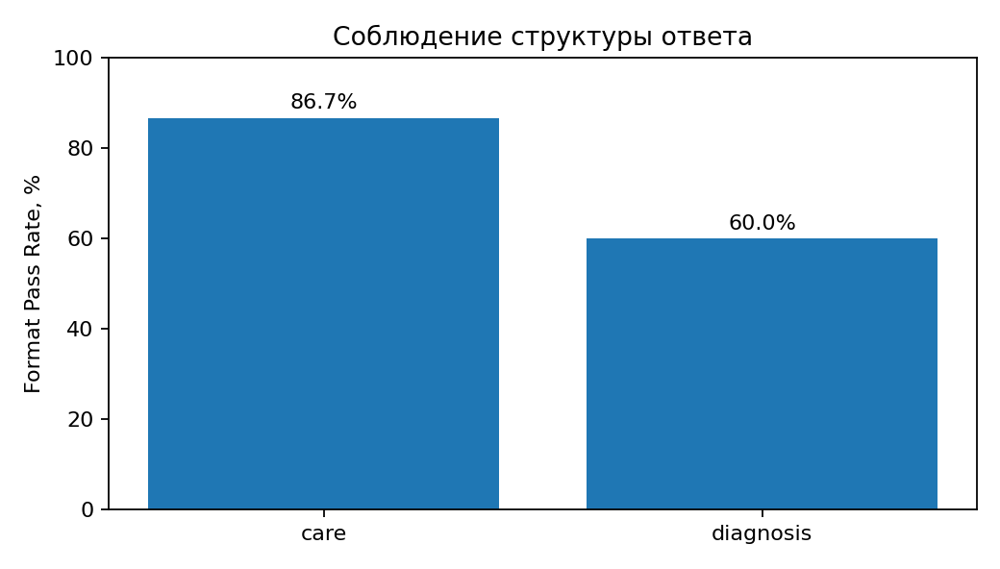
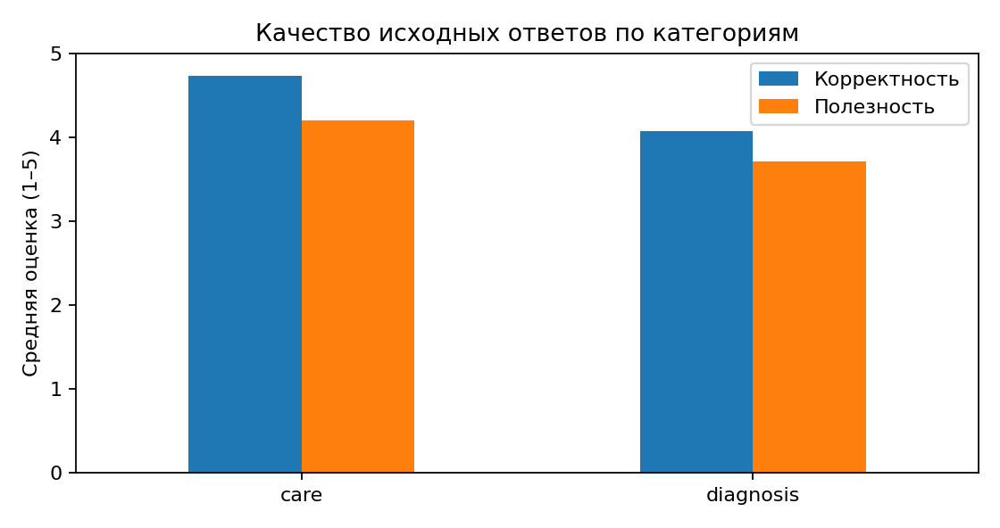
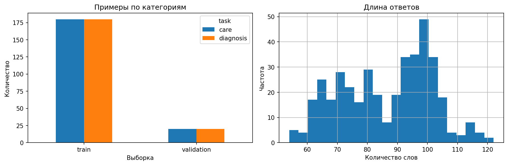

# PlantAdvisor

**Обучение на датасете v3:** [открыть третий ноутбук в Colab](https://colab.research.google.com/github/Batyaoftheyear/plant-advisor/blob/main/notebooks/03_training_and_evaluation_v3.ipynb). Выберите GPU T4, выполните ячейки и подтвердите подключение Google Drive. Входные файлы автоматически загружаются из GitHub с проверкой SHA-256; вручную переносить JSONL не нужно. [Полная инструкция](README_DATASET.md).

Учебный проект по текстовому консультированию на русском языке: уход за комнатными растениями и разбор проблем по описанию симптомов. На первом этапе исследуется исходная `Qwen/Qwen2.5-3B-Instruct` без SFT. Содержание ответов оценивает `Qwen/Qwen2.5-7B-Instruct` в роли LLM-as-judge.

В репозитории опубликованы **30 ответов baseline и 29 успешных оценок судьи**, а также SFT-датасет из **400 диалогов** и выполненный ноутбук его проверки. Оценивание судьи не завершено: для `q16` сохранена техническая ошибка после двух попыток. Его метрики предварительные и рассчитаны только по успешно оценённым ответам.

[Открыть выполненный ноутбук](notebooks/01_baseline_and_judge.ipynb) · [Открыть в Google Colab](https://colab.research.google.com/github/Batyaoftheyear/plant-advisor/blob/main/notebooks/01_baseline_and_judge.ipynb)

[Ноутбук подготовки данных](notebooks/02_dataset.ipynb) · [Подготовка данных в Colab](https://colab.research.google.com/github/Batyaoftheyear/plant-advisor/blob/main/notebooks/02_dataset.ipynb) · [Описание датасета](DATASET_CARD.md)

## Результаты первого этапа

Фиксированный тест содержит 30 вопросов: 15 `care` (уход) и 15 `diagnosis` (диагностика). Он предназначен только для оценки и не должен включаться в будущий обучающий SFT-датасет.

### Соблюдение формата baseline

Format Pass Rate (FPR) проверяет наличие обязательных разделов, их порядок и непустое содержание. Эта метрика не измеряет фактическую правильность советов.

| Выборка | Ответов | Прошли проверку | FPR |
|---|---:|---:|---:|
| Все вопросы | 30 | 22 | 73,3% |
| Уход | 15 | 13 | 86,7% |
| Диагностика | 15 | 9 | 60,0% |

В 2 из 30 генераций достигнут лимит в 512 новых токенов (6,7%). Среднее время ответа в сохранённом прогоне — 23,61 секунды. Полная сводка: [`baseline_metrics.csv`](results/baseline/qwen25_3b_512/baseline_metrics.csv).



### Содержание ответов: LLM-as-judge

Судья выставляет оценки по шкале 1–5. Критерий `diagnostic_reasoning` применяется только к вопросам диагностики. Значения ниже округлены для отображения; исходные CSV и JSONL сохранены без изменений.

| Выборка | Успешных оценок | Корректность | Практическая полезность | Диагностическое рассуждение |
|---|---:|---:|---:|---:|
| Все вопросы | 29 из 30 | 4,414 | 3,966 | 3,357 по 14 вопросам |
| Уход | 15 из 15 | 4,733 | 4,200 | Не применяется |
| Диагностика | 14 из 15 | 4,071 | 3,714 | 3,357 |

`critical_error=true` не отмечен ни в одной из 29 успешных оценок. Это результат модели-судьи, а не доказательство отсутствия предметных ошибок или вредных советов. Обе модели относятся к семейству Qwen и могут разделять ошибки; необходима выборочная ручная проверка. Небольшая выборка и пропущенная оценка ограничивают интерпретацию средних значений.

Для `q16` судья дважды вернул неприемлемое значение `diagnostic_reasoning`. Этот случай присутствует в [`judge_failures.jsonl`](results/judge/qwen25_7b_baseline_v2/judge_failures.jsonl), не получает искусственный нулевой балл и не включён в средние. [`summary.json`](results/judge/qwen25_7b_baseline_v2/summary.json) сохраняет `complete: false`. В журнале [`judge_raw.jsonl`](results/judge/qwen25_7b_baseline_v2/judge_raw.jsonl) находятся все 36 попыток для 30 вопросов, включая повторные.



## Датасет и обучение v3

Комплект `plant_advisor_dataset_stage_v3.zip` интегрирован отдельно от прежних экспериментов:

- `data/v3/` — 360 train, 40 validation, метаданные, происхождение, источники и манифест контрольных сумм;
- `results/dataset/v3/` — предоставленные аудит, распределение сценариев и форма ручной проверки 30 примеров;
- [02_dataset_v3.ipynb](notebooks/02_dataset_v3.ipynb) — отдельная проверка нового набора;
- [03_training_and_evaluation_v3.ipynb](notebooks/03_training_and_evaluation_v3.ipynb) — QLoRA, генерация и сравнительная оценка;
- `scripts/` — сборка, аудит, синхронизация и исходные скрипты из архива;
- [docs/v3/](docs/v3/DATASET_CARD.md) — карточка и [отчёт ревизии](docs/v3/REVISION_REPORT.md).

В v3 представлены 25 растений и 141 семейство сценариев: 132 в train и 9 в validation, без пересечений семейств. Набор синтетический, полная экспертная проверка не выполнена. Новые ноутбуки ещё не содержат результатов GPU-обучения; опубликованы данные и результаты их аудита.

При запуске Colab загружает модуль синхронизации и 12 входных файлов из одного коммита публичного GitHub. Манифест подтверждает версию v3, размер и SHA-256 файлов. Общие контрольные вопросы и baseline не заменяются при конфликте. Старые `data/train.jsonl`, `data/validation.jsonl`, исходные v1-метаданные, выполненные ноутбуки и результаты v2 сохранены без изменений.

Обучение записывает только `results/sft/qwen25_3b_qlora_dataset_v3/`, а тестовые ответы и сравнение — `results/evaluation/qlora_dataset_v3/` на Drive. Настройки: 2 эпохи, LR `3e-5`, LoRA dropout `0.10`, сохранение и валидация каждые 15 шагов. Для авторизации достаточно стандартного окна `drive.mount`; секреты в код не добавляются.

Локальные проверки без GPU:

```bash
python scripts/audit_sft_v3.py
python scripts/sync_colab_data.py --project-root . --verify-local
python -m unittest discover -s tests -v
```

## Подготовка SFT-датасета v2 — сохранённый эксперимент

[Второй ноутбук](notebooks/02_dataset.ipynb) посвящён загрузке и проверке готового синтетического набора: 25 растений, 24 типа сценариев, по 16 примеров на растение. Данные извлечены из `plant_advisor_sft_data_v2.zip` без изменения содержимого JSONL и CSV. История редакции описана в [REVISION_REPORT.md](REVISION_REPORT.md).

| Выборка | Уход (`care`) | Диагностика (`diagnosis`) | Всего |
|---|---:|---:|---:|
| Train | 180 | 180 | 360 |
| Validation | 20 | 20 | 40 |

В validation целиком отложены сценарии `vacation` и `pale_growth`; в train этих типов сценариев нет. Контрольные 30 вопросов сохранены отдельно и совпадают с набором baseline. Проверены соответствие примеров метаданным и источникам, формат диалогов, язык, уникальность и отсутствие точных пересечений с контрольными вопросами. Максимальное TF–IDF-сходство с контрольным вопросом — около 0,455; пар с показателем не ниже 0,85 нет. Смысловая близость типовых ситуаций этой проверкой не исключается.

Все 11 кодовых ячеек второго ноутбука, их выводы, счётчики выполнения и график сохранены. Пояснения отредактированы как самостоятельный отчёт о подготовке данных. Для проверки публикации ячейки анализа отдельно выполнены на CPU. В `results/dataset/` размещены оригинальные Colab-отчёты, скачанные с Google Drive: четыре таблицы/JSON совпадают по содержимому с результатами локальной проверки, а график сохранён в исходном Colab-виде. Выводы в самом ноутбуке не перезаписывались. Контрольные суммы и происхождение файлов — в [манифесте импорта](results/dataset/drive_artifacts_manifest.json).



В [pilot_generation/](results/dataset/pilot_generation/README.md) дополнительно сохранён отдельный пилот генерации по внешним материалам: конфигурация, 8 исходных ответов модели, таблица примеров, индекс 681 источника и результаты проверки. Модель вернула 6 ответов и 2 пропуска; эти примеры не входят в текущие 400 SFT-диалогов. Ограничения пилота, включая неподтверждённое дословное evidence одного ответа, описаны отдельно.

Для повторного анализа откройте второй ноутбук в Colab с обычной CPU-средой, подключите Google Drive и поместите `data/` из репозитория в `MyDrive/plant-advisor/`. Альтернативный вход — исходный архив `plant_advisor_sft_data_v2.zip` в этом же каталоге. Требуемые пакеты: `pandas`, `matplotlib`, `scikit-learn`, `datasets`. Их можно установить командой `%pip install pandas matplotlib scikit-learn datasets`, затем последовательно выполнить ячейки. GPU и загрузка весов модели для этого ноутбука не нужны.

Набор построен синтетически по сценариям. Его источники относятся к общим принципам ухода; полная независимая экспертная проверка всех ответов не проводилась. Форма ручной проверки содержит 24 примера с незаполненными полями оценки. Готовые данные и их проверка доступны в репозитории; скрипты первоначального формирования и ревизии в исходный архив не входили.

## Структура проекта

```text
plant-advisor/
├── .gitattributes
├── .gitignore
├── README.md
├── README_DATASET.md
├── DATASET_CARD.md
├── REVISION_REPORT.md
├── docs/
│   └── v3/                            # карточка v3 и отчёт ревизии
├── scripts/                           # сборка, аудит и синхронизация
├── tests/                             # проверки синхронизации и сохранности версий
├── notebooks/
│   ├── 01_baseline_and_judge.ipynb
│   ├── 02_dataset.ipynb               # выполненный v2, выводы сохранены
│   ├── 02_dataset_v3.ipynb
│   └── 03_training_and_evaluation_v3.ipynb
├── data/
│   ├── eval_questions.jsonl
│   ├── train.jsonl
│   ├── validation.jsonl
│   ├── sft_metadata.jsonl
│   ├── sft_metadata_raw.jsonl
│   ├── sft_provenance.csv
│   ├── sources.csv
│   └── v3/                            # отдельные JSONL/CSV v3 и manifest.json
└── results/
    ├── baseline/
    │   └── qwen25_3b_512/
    │       ├── environment.json
    │       ├── config.json
    │       ├── baseline_answers.jsonl
    │       ├── baseline_answers.csv
    │       ├── quick_run.jsonl
    │       ├── baseline_metrics.csv
    │       ├── format_pass_rate.png
    │       └── summary.json
    ├── judge/
    │   └── qwen25_7b_baseline_v2/
    │       ├── config.json
    │       ├── judge_raw.jsonl
    │       ├── judge_scores.jsonl
    │       ├── judge_scores.csv
    │       ├── judge_failures.jsonl
    │       ├── judge_metrics.csv
    │       ├── judge_scores_by_task.png
    │       └── summary.json
    └── dataset/
        ├── v3/                        # предоставленные отчёты аудита v3
        ├── dataset_audit.json
        ├── dataset_distributions.png
        ├── eval_similarity_audit.csv
        ├── manual_review_sample.csv
        ├── split_distribution.csv
        ├── drive_artifacts_manifest.json
        └── pilot_generation/
            ├── README.md
            ├── generation_config.json
            ├── generated_candidates.jsonl
            ├── pilot_examples.csv
            ├── selected_sources_index.csv
            └── pilot_audit.csv
```

В `quick_run.jsonl` сохранён пробный прогон на двух вопросах; эти же ответы присутствуют в полном baseline. Пробный прогон и необработанные ответы судьи сохранены для проверки происхождения результатов. Два прежних ноутбука содержат выполненные эксперименты, новые варианты v3 подготовлены для запуска. Архивы распространения и веса моделей в Git не добавляются.

## Google Colab: просмотр и запуск

Для изучения результатов достаточно открыть выполненный ноутбук на GitHub или в Colab: выводы ячеек, таблицы и графики уже сохранены. JSONL и CSV также доступны непосредственно в `results/`.

Для работы с вычислительной средой:

1. Откройте ноутбук по ссылке **«Открыть в Google Colab»** выше.
2. Выберите GPU T4 в меню **Среда выполнения → Сменить среду выполнения**. Для генерации необходим доступный GPU.
3. Первая вычислительная ячейка устанавливает `transformers==4.57.6`, `accelerate==1.15.0`, `bitsandbytes==0.50.2`; остальные используемые библиотеки загружаются из среды Colab. Снимок окружения baseline сохранён в `environment.json`.
4. Ячейка настройки подключает Google Drive. Подтвердите доступ к своему Drive. Рабочий каталог ноутбука — `/content/drive/MyDrive/plant-advisor/`, с подкаталогами `data/`, `results/` и `exports/`.
5. Чтобы использовать сохранённый эксперимент, предварительно скопируйте `data/` и `results/` из репозитория в `MyDrive/plant-advisor/`, сохраняя относительные пути. Открытие ноутбука с GitHub само по себе не копирует эти файлы на Drive. Для нового эксперимента используйте отдельное место хранения, чтобы сохранить исходный набор артефактов.

**Ограничение запуска этого снимка:** чистый запуск «Выполнить всё» требует отдельного исправления порядка ячеек. В разделе 7 есть вычислительная ячейка, использующая `JUDGE_CONFIG` до его создания в разделе 8. Кроме того, в сохранённых выводах раздела 8 присутствует `NameError: name 'base_model' is not defined` на строке выгрузки базовой модели. Поэтому данный ноутбук публикуется как выполненный снимок эксперимента с известными проблемами повторного запуска. В рамках подготовки публикации его код, порядок ячеек и выводы не исправлялись. Перед новым полным прогоном требуется исправить эти ошибки отдельным изменением; текущий снимок не обеспечивает выполнение всех ячеек без ошибок.

После исправления порядка выполнения ноутбук рассчитан на последовательную загрузку моделей с 4-битным NF4-квантованием. Для baseline используется жадная генерация с `max_new_tokens=512`, для судьи — `640`; `do_sample=False`, `num_beams=1`, seed `42`. При наличии сохранённых ответов и оценок код пропускает обработанные ID и проверяет совместимость конфигураций. Точные ревизии весов и системные промпты находятся в соответствующих `config.json`; новый результат может зависеть от окружения.

Результаты записываются на Google Drive после каждого вопроса. Последняя ячейка создаёт `MyDrive/plant-advisor/exports/01_baseline_and_judge_artifacts.zip` с каталогами `data/` и `results/`. Архив можно скачать и распаковать в локальную копию проекта. Общие сведения о хранении ноутбуков и временной среде исполнения: [FAQ Google Colab](https://research.google.com/colaboratory/faq.html).

## Проверка целостности и известные расхождения

При подготовке проверены CRC архива и PNG, побайтовое совпадение 17 извлечённых файлов с архивом и неизменность выполненного ноутбука. Проверены уникальность ID, 30 ответов, 29 оценок, связь каждой оценки с исходным вопросом и ответом, согласованность CSV и JSONL, конфигурации и идентификаторы запусков. FPR перепроверен исходной функцией из ноутбука, оценки — его исходным валидатором; агрегированные метрики пересчитаны и совпали с сохранёнными значениями. Каждая успешная оценка прослеживается до валидного ответа из `judge_raw.jsonl`.

- Baseline run ID: `d2968b8641499393`.
- Judge run ID: `c2da1f30eb393c86`.
- SHA-256 `baseline_answers.jsonl`: `6224584a14d66503ae2016109674d530b79e7b736284261beee11e3bf6776813`; совпадает со ссылкой на baseline в конфигурации и сводке судьи.
- SHA-256 канонического набора вопросов: `5e7b370d15fb806c8166c7e17c84a5d3ddf390afb66585c77149d4c69f57efd4`. Он вычисляется по JSON с `ensure_ascii=False`, `sort_keys=True`, `separators=(",", ":")`, как в ноутбуке; это не хеш сырых байтов JSONL.
- SHA-256 выполненного ноутбука: `95659e5cbaa3a1f6e5136523ed007f15e08806f4db51d7720be3d11a23b3254c`.

В заключительном Markdown-разделе ноутбука указан старый путь `results/judge/qwen25_7b_baseline/`. Фактический каталог этого эксперимента — `results/judge/qwen25_7b_baseline_v2/`, он согласован с кодом настройки, архивом и сохранёнными выводами. Старый путь не создавался, текст оригинального ноутбука сохранён.

Отдельный `environment.json` для судьи отсутствует в исходном архиве, хотя код предусматривает его запись. Его содержимое не восстанавливалось предположениями: опубликован только имеющийся снимок окружения baseline. У пяти оценок `care` (`q01`, `q07`, `q11`, `q15`, `q21`) отсутствует вложенный ключ `reasoning.diagnostic_reasoning`; исходный валидатор допускает это как `None`. Эти записи сохранены в оригинальном виде.

`.gitattributes` отключает преобразование переводов строк для данных, результатов и ноутбука, чтобы хеши сохранились при работе на Windows. `.gitignore` исключает локальные окружения, кеши, временные архивы и веса моделей, сохраняя экспериментальные JSONL, CSV, PNG и конфигурации JSON.

Обучение и новое парное сравнение выполняются отдельным ноутбуком v3; результаты появятся после реального GPU-прогона. Прежний тест и сохранённые эксперименты остаются доступны для проверки.
